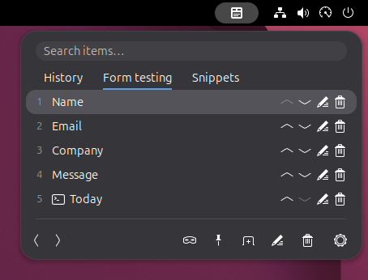
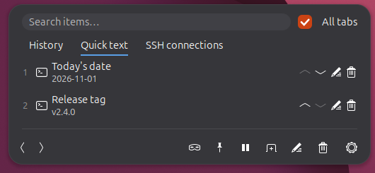
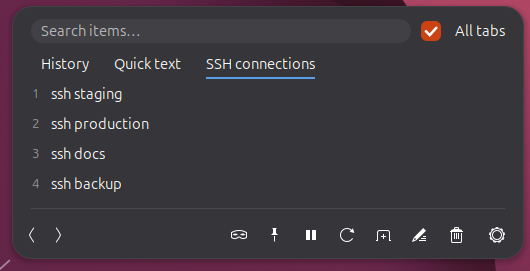

# Paste Board for GNOME

A plain-text clipboard and paste-set manager for GNOME Shell on Wayland.
Organize reusable text in tabs, search across them, and fill forms with repeated
pastes followed by Tab or Enter. Commands can supply text or entire tabs of
paste candidates.



## Install

From the project directory, run:

```bash
make install
```

Requires GNU Make, gettext (`msgfmt`), and GLib's `glib-compile-schemas`.
Commands also require Python 3 at `/usr/bin/python3`.

Log out and back in, then enable **Paste Board for GNOME** in the Extensions app.
Installation links this directory into your extensions folder, so keep it in
place. After updating the source, run `make` and log out and back in.

## Open, search, and paste

Copy text as usual, then open the panel from the top-bar icon. Panel-opening
and number-paste shortcuts are off by default to avoid desktop shortcut conflicts.
Enable them and choose your keys in preferences if desired.

- **Up/Down**, then **Enter**, or a click: paste an item.
- **Your chosen modifiers + 1–9**: paste a numbered candidate, when enabled.
- **Left/Right** outside search: switch tabs.
- Scroll to browse older items; more history loads as you approach the bottom. Number shortcuts stay assigned to the first nine items in the list.
- **Ctrl+F**: switch between search and the last selected candidate.
  **/** outside search also focuses it.
- **Esc**: close the panel.

Type letters or digits anywhere in the panel to start searching, including the
first character. Enabled number shortcuts still paste.

Search covers **All tabs** by default; uncheck it to search only the current tab.
Space-separated words use AND matching, in any order. Results are grouped by tab
and numbered in display order. Clear the query to return to the ordinary list.

The first item in unfiltered history is the current text clipboard. Enter or
clicking an unpinned history item updates the clipboard and moves it to the top.
Number shortcuts, pinned pastes, and pastes from sets preserve both.

Click the **pin** button to keep the panel open for repeated pastes. Choose
**nothing**, **Enter**, or **Tab** after each paste—for example, Tab to fill
successive form fields.

Preferences let you customize shortcuts, history size, trimming, and copy feedback.
**Application paste shortcuts** overrides the paste keys sent to a target app;
match them to that app's settings. Turning off **Paste on Enter or click** makes
those actions copy only; number shortcuts still paste.

**Plain text only:** formatting, images, and other clipboard formats are not
preserved by this extension's paste operations.

## Paste sets

Create a set with the new-tab button at the bottom of the panel. Add history items
with their add button or drag them onto a tab. Edit their names and content, or
drag to reorder them. Right-click a tab to edit or delete it, or use the bottom
toolbar's edit button. Deleting a set requires confirmation; History can only be
renamed. The trash button empties the active history or manual set after
confirmation, keeping the clipboard and tab. It is disabled for generated tabs.

## Commands

Use **Bash (one-liner)** for pipes and variable expansion, or **Direct execution**
for a command and its arguments. Interactive aliases and functions are unavailable.
**Run and preview** lets you try a command in its editor.

### Command items

Edit a set item and select **Command** to paste its output—for example,
`date '+%Y-%m-%d'`. It runs when selected, or reuses an available preview when
**Preview output when opening this tab** is enabled. If no preview has been
loaded—for example, when selecting an unvisited tab's item from search—the command
runs at that point.



### Generated tabs

Create a set, select **Generate from command**, and enter a command. Each non-empty
output line becomes a read-only paste candidate. The first opening during a panel
visit runs the command unless results are already available from search. Revisiting
the tab reuses those results; selecting a candidate pastes without rerunning it.
Use **Refresh** to regenerate the list, or stop a running generation.

Enable **Run command during cross-tab search** to load the tab when a non-empty
all-tabs search begins. Further typing only filters the results; clear and
re-enter the query to run it again. Otherwise, search uses results already loaded
during the current panel visit. Generated results are not saved between visits.

For example, create an **SSH connections** tab in **Bash (one-liner)** mode:

```bash
sed -nE 's/^[[:space:]]*[Hh][Oo][Ss][Tt][[:space:]]+/ssh /p' ~/.ssh/config
```

This produces candidates such as `ssh staging`. Enable search execution to find
connections without opening their tab first. Pasting does not execute the SSH
command. Wildcards and multiple aliases on one line need adjustment; `Include`
files are not read.



### Execution and safety

The bottom toolbar's **pause** button stops automatic previews and generation
until you turn it off. Explicit execution, including selecting a command item,
still works while paused. Private mode blocks command execution.

**Commands run with your permissions and can modify or delete files, access the
network, or launch applications—even without output. Add only commands you
understand and trust. Stopping a command does not undo its actions.**

Commands are limited to 3 seconds and 64 KiB of output; generated tabs allow up to
1000 candidates. Interactive commands and password prompts are unsupported.
Failed commands are not pasted.

## Privacy

Private mode pauses history collection. **Clear history on logout** clears history
between login sessions while keeping paste sets. Recovery backups are retained;
their location is shown in recovery notifications. Clearing history does not
securely erase data from disk.

## Origins and license

Derived from [Gnome Clipboard History](https://github.com/SUPERCILEX/gnome-clipboard-history)
by SUPERCILEX, itself derived from
[Clipboard Indicator](https://github.com/Tudmotu/gnome-shell-extension-clipboard-indicator).

Released under the [MIT License](LICENSE). Original copyright notices and
translator credits are preserved.
