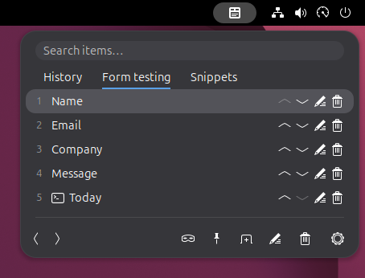

# Paste Board for GNOME

A plain-text clipboard and paste-set manager for GNOME Shell on Wayland.
Keep reusable text in tabs, paste with the keyboard, and fill forms using repeated
pastes followed by Tab or Enter.

- Search your clipboard history and paste previous copies.
- Organize reusable text into your own paste-set tabs.
- Pin the panel to paste several items without reopening it.
- Generate text on demand with command items.



## Install

From the project directory, run:

```bash
make install
```

This requires GNU Make, gettext (`msgfmt`), and GLib's `glib-compile-schemas`.
Command items also require Python 3 at `/usr/bin/python3`.

Log out and log back in, then enable **Paste Board for GNOME** in the Extensions
application. Open the panel from its top-bar icon or with **Super+F1**.

Installation links the project directory into your GNOME Shell extensions folder,
so keep that directory in place. After updating the source, run `make` and log out
and back in to load the changes.

## Paste from history

Copy text as usual, then open the panel to find it in **History**.
The first item in unfiltered history is the current text clipboard.

- Use **Up/Down** to choose an item and **Enter** to paste, or click an item.
- Use **Super+1** through **Super+9** to paste a numbered item in the visible tab.
- Type in the search field to filter items.
- Use **Left/Right** outside the search field to switch tabs.
- Press **Esc** to close the panel.

You can change the panel shortcut and the modifier keys for number shortcuts in
preferences. If you turn off **Paste on Enter or click**, those actions copy the
item instead; number shortcuts still paste.

Use **Application paste shortcuts** in preferences to override the keys sent to
each target app. Choose a preset or record a modifier plus one key. Set the same
shortcut in the target app; removing an override restores automatic behavior.

Choosing a history item with Enter or a click makes it the current clipboard and
moves it to the top. Number shortcuts, pinned pastes, and pastes from sets preserve
the previous clipboard and history order.

**Plain text only:** formatting, images, and other non-text clipboard data are not
preserved by pasting through this extension.

## Paste sets

Use the new-tab button at the bottom of the panel to create a paste set.
Drag items onto its tab, or use a history item's add button to choose a set.
Items are copied, so the originals stay in place.

In a set, edit items to change their names or text, and drag them to change their
order. Use the bottom toolbar's edit button to rename or delete the set.
Paste sets remain saved when you clear clipboard history.

## Repeated pasting

Click the pin button at the bottom of the panel to keep it open while pasting.
Choose whether each paste is followed by **nothing**, **Enter**, or **Tab**.
For example, Tab lets you fill successive form fields from your paste set.
Press Esc when finished.

## Command items

Edit an item in a paste set and select **Command** instead of **Text**.
For example, use `date '+%Y-%m-%d'` to paste today's date.
By default, the command runs each time you choose the item.
Use **Run and preview** in the item editor to test a command before saving.
This is an explicit execution even while automatic previews are paused;
the output is read-only and is not saved with the item.

Enable **Preview output when opening this tab** for commands you want to preview.
Opening the tab then runs the command and shows its output below the item name.
Pasting uses that same output; search and reordering do not run it again.
Selecting a pending preview gives it priority and waits at most 6 seconds.
Closing the panel or switching tabs clears the preview.

Use the pause button in the bottom toolbar to stop automatic previews before
opening a tab. This setting stays on until you turn it off, including after
logging in again. Selecting a command manually still runs and pastes its output.

Use **Direct execution** for a command and its arguments. Choose **Bash
(one-liner)** for pipes, variables, or other shell syntax. Shell startup files
are not loaded, so your interactive aliases and functions are unavailable.

**Commands run with your user permissions and can change or delete files, access
the network, or launch applications—even when they produce no text. Only add
commands you understand and trust. Cancelling a command does not undo its actions.**

Commands must finish within 3 seconds and produce at most 64 KiB of output.
Interactive commands, including password prompts, are unsupported.
Failed commands and empty output are not pasted.

## Privacy and preferences

Use private mode to pause history collection. Preferences let you adjust the
history limit, panel width, whitespace trimming, and copy feedback.
**Clear history on logout** clears history between login sessions while keeping
paste sets. Recovery backups are kept when history is cleared; their location is
shown in the recovery notification. Clearing history does not securely erase data
from disk.

## Origins and license

Derived from [Gnome Clipboard History](https://github.com/SUPERCILEX/gnome-clipboard-history)
by SUPERCILEX, itself derived from
[Clipboard Indicator](https://github.com/Tudmotu/gnome-shell-extension-clipboard-indicator).

Released under the [MIT License](LICENSE). Original copyright notices and
translator credits are preserved.
