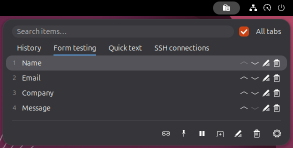
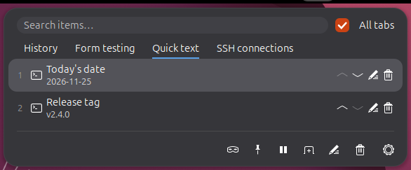
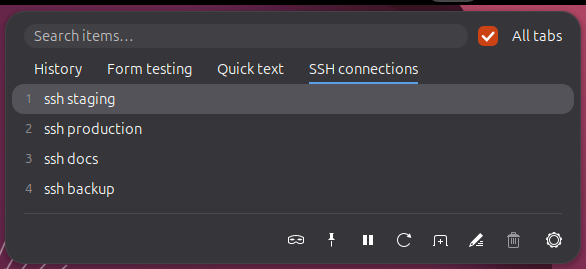

# Paste Board for GNOME

A plain-text clipboard and paste-set manager for GNOME Shell on Wayland.
Organize reusable text in tabs and search across them. Commands can supply
individual items or entire tabs.

**Paste Board pastes plain text without formatting or images.**



## Installation

Supports GNOME Shell 50 on Wayland.

Download or clone this repository and run `make install` from its directory.
Building from source requires GNU Make, gettext, and GLib's
`glib-compile-schemas`. Command features use GJS and the system utilities `setsid` and `kill`.

Keep the downloaded directory in place. Log out and back in, then enable
**Paste Board for GNOME** in the Extensions app.

## Using Paste Board

Copy text as usual and open the panel from the top-bar icon.

- **Up/Down**, then **Enter**, or click an item to paste.
- **Left/Right** to switch tabs when outside the search field.
- Type to search, or use **Ctrl+F** to toggle search focus.
- **Esc** to close the panel.

Search covers all tabs by default. Space-separated words must all match,
in any order. Search results also support editing and deletion where applicable.

Panel-opening and number-paste shortcuts are off by default. Enable and customize
them in preferences.
With number shortcuts enabled, your chosen modifiers + **1–9** paste the
corresponding numbered items.

Click the **pin** icon to keep the panel open for repeated pastes. Choose
whether to send **Enter** or **Tab** after each paste, for example to fill
successive form fields.

Selecting an unpinned history item with Enter or a click moves it to the top
and updates the clipboard. Pinned pastes, number shortcuts, and pastes from
sets preserve the history order and current clipboard.

Preferences let you customize application-specific paste shortcuts or make Enter
and clicks copy only.

## Paste sets

Create a tab with the new-tab button. Add history items using the **+** button
or drag them onto a tab. Edit their names and content, and drag to reorder them.
Right-click a tab to rename or delete it. The trash button empties the current
history or manual set after confirmation.

## Commands

Choose **Direct execution** for a command and its arguments, or **Bash (one-liner)**
for pipes and variable expansion. Use **Run and preview** to try a command in its editor.

### Command items

Edit a paste-set item and select **Command** to paste its output, for example
`date '+%Y-%m-%d'`. You can also enable output previews when opening its tab.



### Generated tabs

Create a tab and select **Generate from command**. Each non-empty output line
becomes a paste candidate. Use the refresh button to regenerate the list.
Enable **Run command during cross-tab search** to include fresh results in
all-tabs searches.

For example, create an **SSH connections** tab in Bash mode:

```bash
sed -nE 's/^[[:space:]]*[Hh][Oo][Ss][Tt][[:space:]]+/ssh /p' ~/.ssh/config
```

The tab lists SSH host definitions as text to paste.



**Commands run with your permissions and can modify or delete files, access
the network, and launch applications. Add only commands you understand and
trust.** Use the pause icon to disable automatic execution. Interactive
commands and password prompts are unsupported.

## Export and import

Export paste sets and settings as JSON from preferences. Clipboard history is
excluded. Import adds sets to your existing ones and optionally restores
preferences and shortcuts. Automatic execution is disabled for imported commands.

## Privacy

Private mode pauses history collection and command execution. Preferences can
clear history on logout while keeping paste sets. Recovery backups may remain;
clearing history does not securely erase data from disk.

## Origins and license

Derived from [Gnome Clipboard History](https://github.com/SUPERCILEX/gnome-clipboard-history)
by SUPERCILEX, itself derived from
[Clipboard Indicator](https://github.com/Tudmotu/gnome-shell-extension-clipboard-indicator).

Many thanks to the original authors and contributors for their work, which made
Paste Board possible.

Released under the [MIT License](LICENSE). Original copyright notices and
translator credits are preserved.
